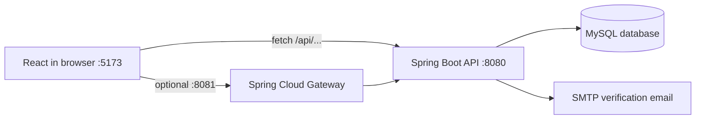
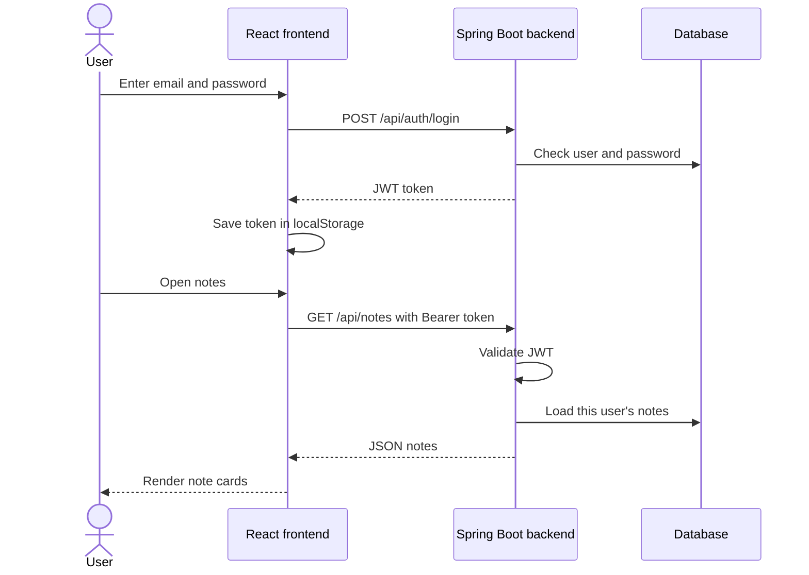

# Fundoo Notes Frontend

A small React application for the [Fundoo Notes backend](https://github.com/Mihir-Lakhani/Bridgelabz-Fundoo-Notes-Backend). The projects are separate repositories. The code is on [develop](https://github.com/Mihir-Lakhani/Bridgelabz-Fundoo-Notes-Frontend/tree/develop); `main` contains only this README.

## Project at a glance

| Item | Choice |
| --- | --- |
| Frontend | React 19 and Vite 8 |
| Routing | React Router |
| Styling | Plain CSS |
| API calls | Browser `fetch` |
| Development URL | `http://localhost:5173` |
| Backend URL | `http://localhost:8080` by default |
| Authentication | Bearer JWT returned by the backend |

## Use cases

Each UC has its own `feature/uc-*` branch from `develop` and a non-fast-forward merge. Commit messages begin with `[Mihir lakhani] :`.

| UC | Feature | What you can do |
| --- | --- | --- |
| 01 | Vite foundation | Start the React app and see a welcome page |
| 02 | Routing and layout | Navigate between workspace pages |
| 03 | Registration and login | Create an account, log in, and guard private pages |
| 04 | Notes CRUD | Create, view, edit, and trash personal notes |
| 05 | Search and actions | Search, pin, and archive notes |
| 06 | Archive and Trash | Unarchive, restore, and permanently delete |
| 07 | Labels | Create labels and attach them to notes |
| 08 | Reminders | Set, view, and remove note reminders |
| 09 | Account management | Update profile, verify email, and reset password |
| 10 | CSV transfer | Import and export notes as CSV |
| 11 | Finalization | Document setup and check the frontend/backend connection |

The matching branches are named `feature/uc-01-vite-foundation` through `feature/uc-11-finalization`. View them in the [branch list](https://github.com/Mihir-Lakhani/Bridgelabz-Fundoo-Notes-Frontend/branches).

## How the two projects connect





The frontend sends the token in the `Authorization` header for protected calls. The backend validates it and checks data ownership. A `401` response sends the user back to login. The token is stored in `localStorage` for this training project.

## Run both projects locally

You need Node.js, npm, Java 21 or newer, Maven, MySQL, and SMTP credentials for registration. Use two terminals. Create the `fundoo_notes` database and configure the backend's MySQL password and SMTP settings as described in its README.

**Terminal 1 — backend**

```powershell
git clone --branch develop https://github.com/Mihir-Lakhani/Bridgelabz-Fundoo-Notes-Backend.git
cd Bridgelabz-Fundoo-Notes-Backend
$env:FUNDOO_JWT_SECRET = "replace-this-with-a-random-secret-of-at-least-32-characters"
mvn spring-boot:run
```

**Terminal 2 — frontend**

```powershell
git clone --branch develop https://github.com/Mihir-Lakhani/Bridgelabz-Fundoo-Notes-Frontend.git
cd Bridgelabz-Fundoo-Notes-Frontend
npm install
npm run dev
```

Open `http://localhost:5173`. The app calls `http://localhost:8080` unless you set `VITE_API_URL`. The backend allows the local Vite origin in its CORS settings. If Vite selects another port, set `FUNDOO_CORS_ALLOWED_ORIGINS` on the backend to include that exact origin and restart it.

If `mvn` is not on your PATH, start the backend from IntelliJ IDEA's Maven tool window, or run the installed `mvn.cmd` by its full path.

For the optional Gateway on port `8081`, copy `.env.example` to `.env.local`, change `VITE_API_URL` to `http://localhost:8081`, and restart Vite. Start the Gateway from the backend repo's `fundoo-api-gateway` directory. Keep the JWT signing secret on the backend; `VITE_` variables are exposed to browser code.

### Email verification and password reset

Registration emails a verification link and takes you to the Verify Email page. Open the link from your inbox; the page verifies the token automatically, then you can log in. Unverified accounts cannot log in. If the link expires, use **Resend verification link** on that page. The backend returns an error if SMTP is unavailable, so check its mail settings if registration fails. Forgot password still uses a one-use reset token. Verification and reset tokens expire after 15 minutes.

### CSV format

The import page accepts a CSV file with exactly these headers:

```csv
title,description
Shopping,Buy milk
Ideas,Plan weekend trip
```

CSV export downloads non-trashed notes as `notes.csv`.

## Pages and backend endpoints

| Frontend page | Backend calls |
| --- | --- |
| Register and Login | `POST /api/auth/register`, `POST /api/auth/login` |
| Dashboard | `GET/POST /api/notes`, `PUT/DELETE /api/notes/{id}`, search and state actions |
| Archive and Trash | `GET /api/notes`, `GET /api/notes/trash`, state actions and permanent delete |
| Labels | `GET/POST/DELETE /api/labels`, note-label actions |
| Reminders | `GET /api/notes`, `PUT/DELETE /api/notes/{id}/reminder` |
| Profile | `GET/PUT /api/users/me` |
| Account help | `POST /api/auth/verify`, `/resend-verification`, `/forgot-password`, `/reset-password` |
| Import and Export | `POST /api/notes/import`, `GET /api/notes/export` |

## Code map

```text
src/
  components/     AppShell, NoteCard, NoteEditor
  pages/          One page for each main screen
  services/       fetch helper and API functions
  App.jsx         Routes and login guard
  App.css         Page and component styles
  index.css       Base styles
```

## Checks

```powershell
npm run lint
npm run build
```

For the earlier connection check, both apps were started together. Registration, login, authenticated profile and notes, reminders, labels, CSV import/export, and the local CORS preflight succeeded against a temporary H2 database. The new email verification flow is covered by backend tests; real SMTP delivery requires your local mail credentials.

The frontend uses components, props, state, effects, forms, conditional rendering, React Router, `fetch`, and plain CSS. It has no state library, UI framework, or form library. Redis, RabbitMQ, Spring Batch, AOP, and scheduled jobs live in the backend.
